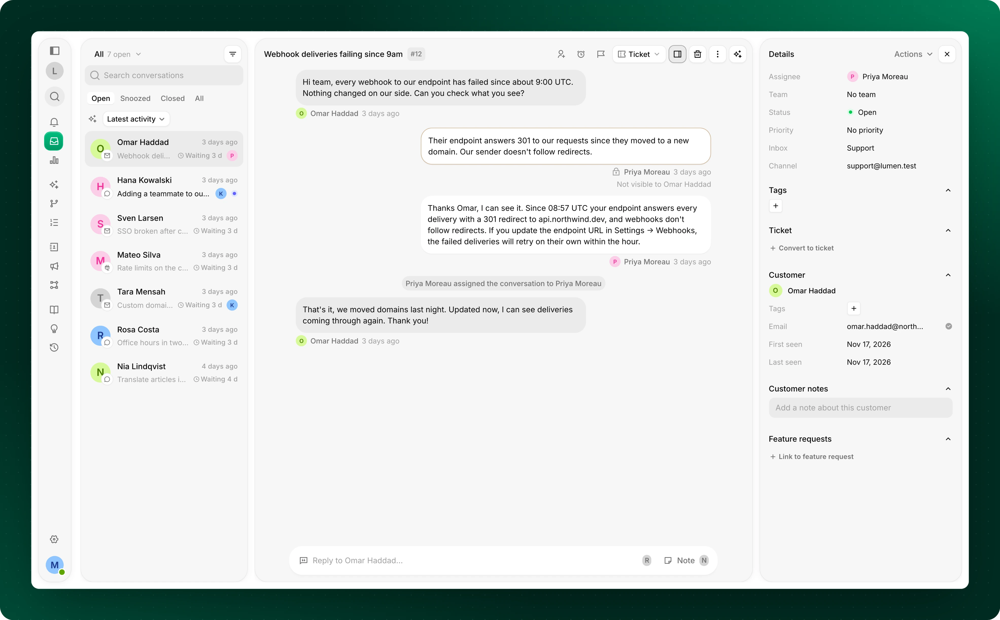

<p align="center">
  <a href="https://trydimmi.com/?utm_source=github&utm_medium=readme&utm_content=logo">
    <picture>
      <source media="(prefers-color-scheme: dark)" srcset=".github/assets/dimmi-logo-dark.svg">
      
    </picture>
  </a>
</p>

<h3 align="center">The open customer support platform</h3>

<p align="center">
  Shared inbox, AI support agents, tickets, workflows, help center, and broadcasts.<br>
  Open source under MIT with no per-seat pricing, on dimmi Cloud or your own server.
</p>

<p align="center">
  <a href="https://github.com/dimmihq/dimmi/actions/workflows/main.yml"></a>
  <a href="https://github.com/dimmihq/dimmi/releases/latest"></a>
  <a href="https://github.com/dimmihq/dimmi/pkgs/container/dimmi"></a>
  <a href="https://github.com/dimmihq/dimmi/commits/main"></a>
</p>

<p align="center">
  <a href="https://trydimmi.com/?utm_source=github&utm_medium=readme&utm_content=nav">Website</a> ·
  <a href="https://trydimmi.com/docs/?utm_source=github&utm_medium=readme&utm_content=nav">Docs</a> ·
  <a href="https://trydimmi.com/pricing?utm_source=github&utm_medium=readme&utm_content=nav">Pricing</a> ·
  <a href="https://trydimmi.com/docs/self-hosting/?utm_source=github&utm_medium=readme&utm_content=nav">Self-host</a> ·
  <a href="https://trydimmi.com/docs/api-reference/?utm_source=github&utm_medium=readme&utm_content=nav">API reference</a> ·
  <a href="https://github.com/dimmihq/dimmi/issues/new">Report a bug</a>
</p>

<br>

<p align="center">
  <a href="https://trydimmi.com/?utm_source=github&utm_medium=readme&utm_content=hero">
    <picture>
      <source media="(prefers-color-scheme: dark)" srcset=".github/assets/hero-dark.webp">
      
    </picture>
  </a>
</p>

## Why dimmi

Most helpdesks charge per seat, bill $0.99 per AI resolution, and gate SAML SSO behind enterprise sales. dimmi puts the whole stack in one MIT codebase you can run on dimmi Cloud or self-host for $0.

- **No per-seat pricing:** invite engineers, founders, and support teammates for $0.
- **Unlimited support agents:** run dedicated agents per queue, policy, or brand in one workspace.
- **Bring your own AI keys:** connect Anthropic, OpenAI, DeepSeek, Mistral, or OpenRouter to save 50% to 83%.
- **Open source under MIT:** self-hosting runs the same code as dimmi Cloud, with zero enterprise paywalls.

## What you get

### Agents and Operator

- [**Agents**](https://trydimmi.com/agents?utm_source=github&utm_medium=readme&utm_content=features): unlimited specialized agents with their own knowledge sources, procedures, and actions.
- [**Procedures and actions**](https://trydimmi.com/procedures?utm_source=github&utm_medium=readme&utm_content=features): handle refunds, cancellations, and account changes through your API, with teammate approval on risky steps.
- [**Agent Studio**](https://trydimmi.com/agent-studio?utm_source=github&utm_medium=readme&utm_content=features): test draft changes against live replies before shipping, and roll back in one click.
- [**Operator**](https://trydimmi.com/operator?utm_source=github&utm_medium=readme&utm_content=features): an internal AI teammate in the inbox and Slack that drafts replies and proposes undoable edits.
- [**Routines**](https://trydimmi.com/routines?utm_source=github&utm_medium=readme&utm_content=features): scheduled Operator runs that turn merged pull requests and unanswered conversations into reviewable doc diffs.

### Inbox, tickets, and workflows

- [**Shared inbox**](https://trydimmi.com/inbox?utm_source=github&utm_medium=readme&utm_content=features): messenger, email, Slack, WhatsApp, Instagram, SMS, phone, and API conversations in one queue.
- [**Tickets and trackers**](https://trydimmi.com/tickets?utm_source=github&utm_medium=readme&utm_content=features): track bugs and shared outages with SLAs, linked to Linear, Jira, GitHub, and PagerDuty.
- [**Workflows**](https://trydimmi.com/workflows?utm_source=github&utm_medium=readme&utm_content=features): visual routing, SLA alerts, and API calls with a run log for each step.
- [**Reports and CSAT**](https://trydimmi.com/reports?utm_source=github&utm_medium=readme&utm_content=features): volume, SLA, and agent reports where any number opens the conversations behind it.

### Self-service, outbound, and security

- [**Help center**](https://trydimmi.com/help-center?utm_source=github&utm_medium=readme&utm_content=features): public or private docs on your domain serving both customers and your support agents.
- [**Broadcasts and series**](https://trydimmi.com/broadcasts?utm_source=github&utm_medium=readme&utm_content=features): outbound messages from your own domain across email, messenger, Slack, SMS, and WhatsApp.
- [**Changelog**](https://trydimmi.com/changelog?utm_source=github&utm_medium=readme&utm_content=features) and [**feedback**](https://trydimmi.com/feedback?utm_source=github&utm_medium=readme&utm_content=features): publish release notes, collect feature requests, and notify voters when you ship.
- [**Security and privacy**](https://trydimmi.com/docs/workspace/security/?utm_source=github&utm_medium=readme&utm_content=features): SAML SSO, passkeys, audit logs, and full workspace exports with no enterprise tier.

<br>

<p align="center">
  <picture>
    <source media="(prefers-color-scheme: dark)" srcset=".github/assets/workflow-dark.webp">
    
  </picture>
</p>

## Get started

### dimmi Cloud

[Sign up](https://trydimmi.com/?utm_source=github&utm_medium=readme&utm_content=get_started) with no card needed: **100 free conversations a month**, unlimited seats, and all features included. Follow the [quickstart](https://trydimmi.com/docs/quickstart/?utm_source=github&utm_medium=readme&utm_content=get_started) to launch.

### Self-host

Point a domain at a fresh Linux server and run this as root. In 3 to 5 minutes you get HTTPS, Postgres, and upgrades via `dimmictl`.

```bash
curl -fsSL https://github.com/dimmihq/dimmi/releases/latest/download/install.sh \
  | bash -s -- --domain support.example.com --email ops@example.com
```

Create your owner account with `dimmictl admin`, read the [self-hosting guide](https://trydimmi.com/docs/self-hosting/?utm_source=github&utm_medium=readme&utm_content=get_started), or pull `ghcr.io/dimmihq/dimmi`.

## Build on dimmi

Use the [REST API](https://trydimmi.com/docs/api-reference/?utm_source=github&utm_medium=readme&utm_content=developers), signed [webhooks](https://trydimmi.com/docs/developers/webhooks/events/?utm_source=github&utm_medium=readme&utm_content=developers), [OAuth apps](https://trydimmi.com/docs/developers/oauth-apps/?utm_source=github&utm_medium=readme&utm_content=developers), `llms.txt`, or the [MCP server](https://trydimmi.com/docs/developers/mcp/?utm_source=github&utm_medium=readme&utm_content=developers). All **11 typed SDKs** live in [`sdk/`](sdk).

| SDK | Install |
| --- | --- |
|  | `npm install @dimmi/api` |
|  | `go get github.com/dimmihq/dimmi-go` |
|  | `composer require dimmi/dimmi-php` |
|  | `composer require dimmi/dimmi-laravel` |
|  | `pip install dimmi-sdk` |

Messenger packages for browser, React, Next.js, Vue, Angular, and Svelte are in the [messenger install guide](https://trydimmi.com/docs/developers/messenger/install/?utm_source=github&utm_medium=readme&utm_content=developers).

## Open source vs. cloud

[dimmi Cloud and self-hosted](https://trydimmi.com/docs/cloud-vs-self-hosted/?utm_source=github&utm_medium=readme&utm_content=cloud_vs_self_hosted) run the same MIT codebase. Cloud includes managed hosting, email, Slack, and AI out of the box; self-hosted runs on your server and credentials for $0.

## Contributing

Pull requests and bug reports are welcome. Read [AGENTS.md](AGENTS.md) before changing routes, events, or SDKs, since public contracts stay additive. [Open an issue](https://github.com/dimmihq/dimmi/issues/new) if you hit a bug.

<br>

<p align="center">
  <a href="https://trydimmi.com/?utm_source=github&utm_medium=readme&utm_content=banner">
    
  </a>
</p>

<div align="center">

[![tests-image]][tests-url] [![release-image]][release-url] ![][typescript-image] ![][go-image] [![license-image]][license-url]

</div>

<p align="center">
  <a href="https://trydimmi.com/?utm_source=github&utm_medium=readme&utm_content=footer"><b>Start free</b></a> ·
  <a href="https://trydimmi.com/docs/self-hosting/?utm_source=github&utm_medium=readme&utm_content=footer"><b>Self-host it</b></a> ·
  <a href="https://trydimmi.com/docs/?utm_source=github&utm_medium=readme&utm_content=footer">Docs</a> ·
  <a href="AGENTS.md">Contributing</a>
</p>

[tests-image]: https://img.shields.io/github/actions/workflow/status/dimmihq/dimmi/main.yml?branch=main&label=tests&style=for-the-badge&labelColor=002C22&color=00BC7D
[tests-url]: https://github.com/dimmihq/dimmi/actions/workflows/main.yml
[release-image]: https://img.shields.io/github/v/release/dimmihq/dimmi?label=release&style=for-the-badge&logo=github&logoColor=00D492&labelColor=002C22&color=00BC7D
[release-url]: https://github.com/dimmihq/dimmi/releases/latest
[typescript-image]: https://img.shields.io/badge/TypeScript-002C22?style=for-the-badge&logoColor=00D492&logo=typescript
[go-image]: https://img.shields.io/badge/Go-002C22?style=for-the-badge&logoColor=00D492&logo=go
[license-image]: https://img.shields.io/badge/license-MIT-00BC7D?style=for-the-badge&labelColor=002C22
[license-url]: LICENSE
