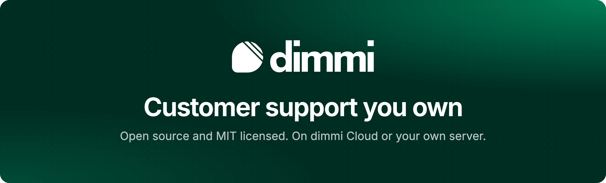

<p align="center">
  <a href="https://trydimmi.com/?utm_source=github&utm_medium=readme&utm_content=logo">
    <picture>
      <source media="(prefers-color-scheme: dark)" srcset=".github/assets/dimmi-logo-dark.svg">
      
    </picture>
  </a>
</p>

<h3 align="center">The open customer support platform</h3>

<p align="center">
  Shared inbox, unlimited specialized support agents, Agent Studio, procedures, Operator, scheduled routines,<br>
  tickets, workflows, help center, and broadcasts. MIT licensed, with no per-seat pricing, on dimmi Cloud or your own server.
</p>

<p align="center">
  <a href="https://github.com/dimmihq/dimmi/actions/workflows/main.yml"></a>
  <a href="https://github.com/dimmihq/dimmi/releases/latest"></a>
  <a href="https://github.com/dimmihq/dimmi/pkgs/container/dimmi"></a>
  <a href="https://github.com/dimmihq/dimmi/commits/main"></a>
</p>

<p align="center">
  <a href="https://trydimmi.com/?utm_source=github&utm_medium=readme&utm_content=nav">Website</a> ·
  <a href="https://trydimmi.com/docs/?utm_source=github&utm_medium=readme&utm_content=nav">Docs</a> ·
  <a href="https://trydimmi.com/compare?utm_source=github&utm_medium=readme&utm_content=nav">Compare</a> ·
  <a href="https://trydimmi.com/pricing?utm_source=github&utm_medium=readme&utm_content=nav">Pricing</a> ·
  <a href="https://trydimmi.com/docs/self-hosting/?utm_source=github&utm_medium=readme&utm_content=nav">Self-host</a> ·
  <a href="https://trydimmi.com/docs/api-reference/?utm_source=github&utm_medium=readme&utm_content=nav">API reference</a> ·
  <a href="https://github.com/dimmihq/dimmi/issues/new">Report a bug</a>
</p>

<br>

<p align="center">
  <a href="https://trydimmi.com/?utm_source=github&utm_medium=readme&utm_content=hero">
    <picture>
      <source media="(prefers-color-scheme: dark)" srcset=".github/assets/hero-dark.webp">
      
    </picture>
  </a>
</p>

## Why dimmi

Most support stacks charge per seat to keep engineers out of the inbox, bill $0.99 per AI resolution, and lock SAML SSO behind an enterprise sales call. dimmi ships the entire customer support platform in one codebase, all open source under MIT, so you can run on dimmi Cloud or self-host for $0.

- **No per-seat pricing:** invite every engineer, founder, and support teammate for $0.
- **Unlimited support agents:** run dedicated agents for frontline support, billing, technical docs, orders, and separate brands in one workspace.
- **Bring your own AI keys:** connect Anthropic, OpenAI, DeepSeek, Mistral, or OpenRouter to cut AI fees by 50% to 83%.
- **Fully open source (MIT):** self-hosting runs the exact same code as dimmi Cloud, with zero features held back for an enterprise tier.

## What you get

### Support agents and backstage AI

- [**Agents**](https://trydimmi.com/agents?utm_source=github&utm_medium=readme&utm_content=features): run as many specialized support agents as you need, each locked to its own knowledge sources, procedures, and actions. Replies cite your docs, transfer quietly between peer specialists, and hand over to a teammate with a summary when docs run out.
- [**Agent Studio**](https://trydimmi.com/agent-studio?utm_source=github&utm_medium=readme&utm_content=features): write guidance with `@` chips, test drafts across multi-run simulations scored with written checks, compare Draft against Live side by side, inspect versions, and roll back in one click.
- [**Procedures and actions**](https://trydimmi.com/procedures?utm_source=github&utm_medium=readme&utm_content=features): write policies in plain English for refunds, cancellations, and account changes. Agents call your backend through HTTP or MCP actions, follow hard limits, and pause for teammate approval before anything you cannot undo.
- [**Knowledge sources**](https://trydimmi.com/docs/ai/knowledge-sources/?utm_source=github&utm_medium=readme&utm_content=features): keep your support agents current from your help center, websites, uploaded files, GitHub, Notion, Intercom, and Zendesk.
- [**Operator**](https://trydimmi.com/operator?utm_source=github&utm_medium=readme&utm_content=features): an internal AI teammate on its own page, beside every thread, inside article and procedure editors, and in Slack. Reads workspace conversation memory, triages new threads, drafts replies in your team's voice, and proposes edits as undoable changesets.
- [**Routines**](https://trydimmi.com/routines?utm_source=github&utm_medium=readme&utm_content=features): put Operator on a daily, weekly, or custom schedule to sync merged GitHub pull requests to help articles, audit knowledge gaps and stale docs, review handovers, and tune policies. Leaves inline diffs for human review and stays quiet when nothing changed.

### Shared inbox, tickets, and automation

- [**Inbox and messenger**](https://trydimmi.com/inbox?utm_source=github&utm_medium=readme&utm_content=features): messenger (with signed identity verification), email, Slack, WhatsApp, Instagram, Facebook Messenger, SMS, phone, and REST API threads in one queue. Includes multiple inboxes, saved views, saved replies, office hours, internal notes, undo send, round-robin assignment, and snoozes.
- [**Customers and audiences**](https://trydimmi.com/docs/customers/customers-and-companies/?utm_source=github&utm_medium=readme&utm_content=features): full customer and company profiles with custom attributes, tracked product events, and dynamic audiences that power routing, broadcasts, help center access, and agents.
- [**Tickets and trackers**](https://trydimmi.com/tickets?utm_source=github&utm_medium=readme&utm_content=features): custom ticket types and states, back-office escalations, multi-customer incident trackers that update every affected customer once, business-hour SLA timers, and links to Linear, Jira, GitHub, incident.io, Rootly, and PagerDuty.
- [**Workflows**](https://trydimmi.com/workflows?utm_source=github&utm_medium=readme&utm_content=features): a visual automation canvas triggered by messages, product events, tags, SLA alerts, or schedules, with branching rules, API calls, and a full run log for every step.
- [**Reports and CSAT**](https://trydimmi.com/reports?utm_source=github&utm_medium=readme&utm_content=features): built-in and custom reports for volume, response times, SLA compliance, customer ratings, and side-by-side agent comparisons. Every number opens the exact conversations behind it.

### Self-service and outbound

- [**Help center**](https://trydimmi.com/help-center?utm_source=github&utm_medium=readme&utm_content=features): public or audience-restricted docs on your custom domain that serve both customers and your support agents from one source of truth, with Markdown copies for AI tools and stale-translation alerts.
- [**Broadcasts and series**](https://trydimmi.com/broadcasts?utm_source=github&utm_medium=readme&utm_content=features): send one-off announcements and behavioral series from your own verified sending domain across email, messenger, Slack, SMS, and WhatsApp. Every reply opens a real conversation in your inbox.
- [**Changelog**](https://trydimmi.com/changelog?utm_source=github&utm_medium=readme&utm_content=features): publish release notes once to reach customers on your help center, inside the messenger tab with an unread dot, and by email.
- [**Feedback and roadmap**](https://trydimmi.com/feedback?utm_source=github&utm_medium=readme&utm_content=features): feature request boards and a public roadmap linked to live conversations and your changelog so every voter hears when you ship what they asked for.

### Security and data ownership

- [**Security without an enterprise tax**](https://trydimmi.com/docs/workspace/security/?utm_source=github&utm_medium=readme&utm_content=features): SAML SSO, passkeys, two-factor auth, roles and permissions, audit logs, and conversation safety are included on Cloud and self-hosted.
- [**Privacy and portability**](https://trydimmi.com/docs/customers/erase-data/?utm_source=github&utm_medium=readme&utm_content=features): configurable retention policies, customer data exports and erasures, and full workspace archive exports belong to every workspace on day one.

<br>

<p align="center">
  <picture>
    <source media="(prefers-color-scheme: dark)" srcset=".github/assets/workflow-dark.webp">
    
  </picture>
</p>

## Get started

### dimmi Cloud

[Sign up](https://trydimmi.com/?utm_source=github&utm_medium=readme&utm_content=get_started) with no card needed and answer your first conversation in minutes. Every workspace gets **100 free conversations every month**, unlimited free seats, and every feature unlocked. Walk through setup in the [quickstart](https://trydimmi.com/docs/quickstart/?utm_source=github&utm_medium=readme&utm_content=get_started).

### Self-host

Point a domain at a fresh Linux server and run the installer as root. Setup takes 3 to 5 minutes and includes HTTPS, Postgres, and upgrades with `dimmictl`.

```bash
curl -fsSL https://github.com/dimmihq/dimmi/releases/latest/download/install.sh \
  | bash -s -- --domain support.example.com --email ops@example.com
```

Create the first owner with `dimmictl admin`, then sign in. Read [requirements, configuration, and upgrades](https://trydimmi.com/docs/self-hosting/?utm_source=github&utm_medium=readme&utm_content=get_started) in the docs, or run the container image directly from `ghcr.io/dimmihq/dimmi`.

## Build on dimmi

dimmi ships with a versioned [REST API](https://trydimmi.com/docs/api-reference/?utm_source=github&utm_medium=readme&utm_content=developers), signed [webhooks](https://trydimmi.com/docs/developers/webhooks/events/?utm_source=github&utm_medium=readme&utm_content=developers), [OAuth apps](https://trydimmi.com/docs/developers/oauth-apps/?utm_source=github&utm_medium=readme&utm_content=developers), `llms.txt`, and an [MCP server](https://trydimmi.com/docs/developers/mcp/?utm_source=github&utm_medium=readme&utm_content=developers) that lets any coding agent do Operator's work with tools that explain their own inputs. All **11 typed SDKs** live in [`sdk/`](sdk).

| SDK | Install |
| --- | --- |
|  | `npm install @dimmi/api` |
|  | `go get github.com/dimmihq/dimmi-go` |
|  | `composer require dimmi/dimmi-php` |
|  | `composer require dimmi/dimmi-laravel` |
|  | `pip install dimmi-sdk` |

The messenger also ships typed packages for the browser, React, Next.js, Vue, Angular, and Svelte. See the [messenger install guide](https://trydimmi.com/docs/developers/messenger/install/?utm_source=github&utm_medium=readme&utm_content=developers).

## Open source vs. cloud

All of dimmi is MIT licensed, with zero features held back for an enterprise edition. [dimmi Cloud and a self-hosted server](https://trydimmi.com/docs/cloud-vs-self-hosted/?utm_source=github&utm_medium=readme&utm_content=cloud_vs_self_hosted) run the exact same code. On dimmi Cloud we manage hosting, email, Slack, and managed AI out of the box; self-hosted, you bring your own server and credentials and pay us $0.

## Contributing

Issues and pull requests are welcome. Read [AGENTS.md](AGENTS.md) before changing routes, events, or SDKs: the API and SDKs are public contracts, so changes stay additive. Found a bug? [Open an issue](https://github.com/dimmihq/dimmi/issues/new).

<br>

<p align="center">
  <a href="https://trydimmi.com/?utm_source=github&utm_medium=readme&utm_content=banner">
    
  </a>
</p>

<div align="center">

[![tests-image]][tests-url] [![release-image]][release-url] ![][typescript-image] ![][go-image] [![license-image]][license-url]

</div>

<p align="center">
  <a href="https://trydimmi.com/?utm_source=github&utm_medium=readme&utm_content=footer"><b>Start free</b></a> ·
  <a href="https://trydimmi.com/docs/self-hosting/?utm_source=github&utm_medium=readme&utm_content=footer"><b>Self-host it</b></a> ·
  <a href="https://trydimmi.com/docs/?utm_source=github&utm_medium=readme&utm_content=footer">Docs</a> ·
  <a href="https://trydimmi.com/compare?utm_source=github&utm_medium=readme&utm_content=footer">Compare</a> ·
  <a href="AGENTS.md">Contributing</a>
</p>

[tests-image]: https://img.shields.io/github/actions/workflow/status/dimmihq/dimmi/main.yml?branch=main&label=tests&style=for-the-badge&labelColor=002C22&color=00BC7D
[tests-url]: https://github.com/dimmihq/dimmi/actions/workflows/main.yml
[release-image]: https://img.shields.io/github/v/release/dimmihq/dimmi?label=release&style=for-the-badge&logo=github&logoColor=00D492&labelColor=002C22&color=00BC7D
[release-url]: https://github.com/dimmihq/dimmi/releases/latest
[typescript-image]: https://img.shields.io/badge/TypeScript-002C22?style=for-the-badge&logoColor=00D492&logo=typescript
[go-image]: https://img.shields.io/badge/Go-002C22?style=for-the-badge&logoColor=00D492&logo=go
[license-image]: https://img.shields.io/badge/license-MIT-00BC7D?style=for-the-badge&labelColor=002C22
[license-url]: LICENSE
