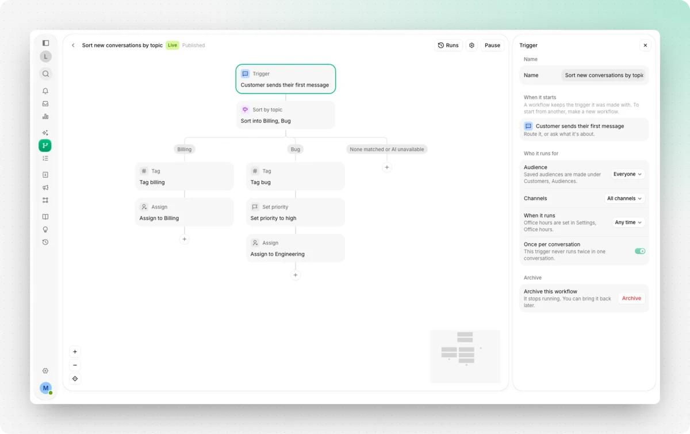

<p align="center">
  <a href="https://trydimmi.com">
    <picture>
      <source media="(prefers-color-scheme: dark)" srcset=".github/assets/dimmi-logo-dark.svg">
      
    </picture>
  </a>
</p>

<h3 align="center">Customer support you own</h3>

<p align="center">
  Open-source customer support, MIT licensed. A messenger, a shared inbox, tickets,<br>
  an AI agent and an API, on dimmi Cloud or your own server.
</p>

<p align="center">
  <a href="https://github.com/dimmihq/dimmi/actions/workflows/main.yml"></a>
  <a href="https://github.com/dimmihq/dimmi/releases/latest"></a>
  <a href="https://github.com/dimmihq/dimmi/pkgs/container/dimmi"></a>
  <a href="https://github.com/dimmihq/dimmi/graphs/contributors"></a>
  <a href="https://github.com/dimmihq/dimmi/commits/main"></a>
</p>

<p align="center">
  <a href="https://trydimmi.com">Website</a> ·
  <a href="https://trydimmi.com/docs/">Docs</a> ·
  <a href="https://trydimmi.com/docs/self-hosting/">Self-host</a> ·
  <a href="https://trydimmi.com/docs/api-reference/">API reference</a> ·
  <a href="https://trydimmi.com/changelog">Changelog</a> ·
  <a href="https://github.com/dimmihq/dimmi/issues/new">Report a bug</a>
</p>

<br>

<p align="center">
  <a href="https://trydimmi.com">
    <picture>
      <source media="(prefers-color-scheme: dark)" srcset=".github/assets/hero-dark.webp">
      
    </picture>
  </a>
</p>

## What you get

Your team answers messenger, email and Slack conversations from one inbox. The AI agent answers first, from your own knowledge, and hands over when it should. It all runs on our cloud or on one server of yours.

**Talk to customers**

- [Inbox](https://trydimmi.com/inbox): messenger, email, Slack and the API in one place, with customer context, notes, assignment and snoozes.
- [Messenger](https://trydimmi.com/docs/channels/install-the-messenger/): a chat widget for your site or app, with signed identity for logged-in users.
- [Broadcasts](https://trydimmi.com/broadcasts): send broadcasts and series from your own inbox. Every reply comes back as a conversation.

**Let AI do the first pass**

- [AI agent](https://trydimmi.com/agent): answers from your help center and knowledge sources, then hands over to a person.
- [Procedures](https://trydimmi.com/procedures): write how your team handles a request in plain words. The agent follows it and waits for approval where you say.
- [Operator](https://trydimmi.com/operator): briefs your team on a conversation, drafts replies and proposes changes you apply.

**Track the work**

- [Tickets](https://trydimmi.com/tickets): your own types and states, SLAs, and links to Linear, Jira and GitHub.
- [Workflows](https://trydimmi.com/workflows): a visual canvas to route, tag, reply and escalate on any trigger.
- [Reports](https://trydimmi.com/reports): volume, response times, CSAT and how often the agent resolves. Every number opens the conversations behind it.

**Help customers help themselves**

- [Help center](https://trydimmi.com/help-center): articles on your own domain, which the AI agent answers from.
- [Changelog](https://trydimmi.com/changelog): product updates on a public page, in the messenger and by email.
- [Feedback](https://trydimmi.com/feedback): feature request boards and a public roadmap. Voters hear when it ships.

<br>

<p align="center">
  <picture>
    <source media="(prefers-color-scheme: dark)" srcset=".github/assets/workflow-dark.webp">
    
  </picture>
</p>

## Get started

### dimmi Cloud

[Sign up](https://trydimmi.com) and answer your first conversation in a few minutes. The first 100 conversations every month are free, with unlimited seats. The [quickstart](https://trydimmi.com/docs/quickstart/) walks you through it.

### Self-host

Point a host name at a fresh Linux server, then run the installer as root. It takes 3 to 5 minutes.

```bash
curl -fsSL https://github.com/dimmihq/dimmi/releases/latest/download/install.sh \
  | bash -s -- --domain support.example.com --email ops@example.com
```

Create the first owner with `dimmictl admin`, then sign in. [Requirements, configuration and upgrades](https://trydimmi.com/docs/self-hosting/) are in the docs. Prefer to run the image yourself? It's `ghcr.io/dimmihq/dimmi`.

## Build on dimmi

dimmi has a [REST API](https://trydimmi.com/docs/api-reference/), [webhooks](https://trydimmi.com/docs/developers/webhooks/events/), [OAuth apps](https://trydimmi.com/docs/developers/oauth-apps/) and an [MCP server](https://trydimmi.com/docs/developers/mcp/). The SDKs live in [`sdk/`](sdk).

| SDK | Install |
| --- | --- |
|  | `npm install @dimmi/api` |
|  | `go get github.com/dimmihq/dimmi-go` |
|  | `composer require dimmi/dimmi-php` |
|  | `composer require dimmi/dimmi-laravel` |
|  | `pip install dimmi-sdk` |

The messenger has packages for the browser, React, Next.js, Vue, Angular and Svelte. See the [messenger install guide](https://trydimmi.com/docs/developers/messenger/install/).

## Open source vs. cloud

dimmi is MIT licensed, all of it. [dimmi Cloud and a self-hosted server](https://trydimmi.com/docs/cloud-vs-self-hosted/) run the same code with the same features. On the cloud we run the server and email, Slack and AI work out of the box. Self-hosted, you bring those credentials and pay nothing.

## Contributing

Issues and pull requests are welcome. Read [AGENTS.md](AGENTS.md) first: the API and the SDKs are public contracts, so changes to them are additive only. Found a bug? [Open an issue](https://github.com/dimmihq/dimmi/issues/new).

<br>

<p align="center">
  <a href="https://trydimmi.com">
    
  </a>
</p>

<div align="center">

[![tests-image]][tests-url] [![release-image]][release-url] ![][typescript-image] ![][go-image] [![license-image]][license-url]

</div>

<p align="center">
  <a href="https://trydimmi.com"><b>Start free</b></a> ·
  <a href="https://trydimmi.com/docs/self-hosting/"><b>Self-host it</b></a> ·
  <a href="https://trydimmi.com/docs/">Docs</a> ·
  <a href="AGENTS.md">Contributing</a>
</p>

[tests-image]: https://img.shields.io/github/actions/workflow/status/dimmihq/dimmi/main.yml?branch=main&label=tests&style=for-the-badge&labelColor=002C22&color=00BC7D
[tests-url]: https://github.com/dimmihq/dimmi/actions/workflows/main.yml
[release-image]: https://img.shields.io/github/v/release/dimmihq/dimmi?label=release&style=for-the-badge&logo=github&logoColor=00D492&labelColor=002C22&color=00BC7D
[release-url]: https://github.com/dimmihq/dimmi/releases/latest
[typescript-image]: https://img.shields.io/badge/TypeScript-002C22?style=for-the-badge&logoColor=00D492&logo=typescript
[go-image]: https://img.shields.io/badge/Go-002C22?style=for-the-badge&logoColor=00D492&logo=go
[license-image]: https://img.shields.io/badge/license-MIT-00BC7D?style=for-the-badge&labelColor=002C22
[license-url]: LICENSE
